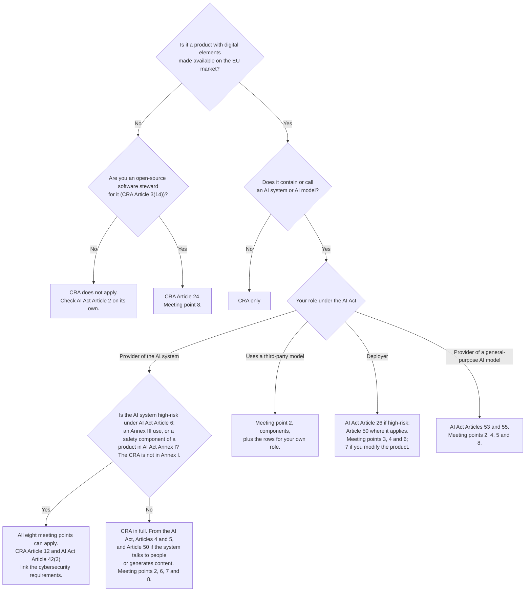

# White paper on AI Act and CRA compliance overlaps

## Abstract

A product with digital elements that is, or contains, an AI system can fall under both the Cyber Resilience Act (CRA) and the AI Act. This white paper maps where the two acts meet. It finds eight meeting points: cybersecurity requirements, components, recording activity, reporting, technical documentation, information to users, updates and changes, and open source. For each one it sets out what each act asks of each role, what evidence shows the duty was met, and who can look at that evidence.

The paper is an orientation map, not a compliance checklist. It helps a reader who knows one act find the matching provisions in the other, and it lists the questions the two texts leave open. It does not cover data protection, copyright beyond the duties of general-purpose AI model providers, or the work of fundamental rights authorities.

In brief:

- The two acts link at one point in law: under CRA [Article 12][cra12], a high-risk AI system can meet the AI Act's cybersecurity requirement through the CRA.
- Elsewhere they run side by side, and one organisation often holds roles under both. The eight meeting points below show which duty falls on whom.
- Neither act asks for evidence that a third party can check without trusting the holder. That gap is where the SIG's next drafts can add the most.

This document does not constitute legal guidance; it reflects the current understanding of the CRA and the AI Act held by its contributors.

## Status of this document

This document is a draft and may be updated, replaced, or obsoleted at any time. It is inappropriate to cite this document as anything other than a work in progress. Publication of this draft does not imply endorsement by the Eclipse Foundation, the Open Regulatory Compliance Working Group, or any of its members or contributors.

This first draft was proposed to the AI Policy and Compliance SIG in [orcwg/orcwg#373][i373]. Its core is the table first proposed for the CRA FAQ in [orcwg/cra-hub#364][pr364], where reviewers asked for it to become a separate SIG deliverable. Comments are welcome on the pull request that adds this file.

## Introduction

The CRA ([Regulation (EU) 2024/2847][CRA]) sets cybersecurity requirements for products with digital elements. The AI Act ([Regulation (EU) 2024/1689][AI Act], as amended by the [Digital Omnibus on AI][omnibus], Regulation (EU) 2026/1744) sets requirements for AI systems and general-purpose AI models. The two acts were written separately and use different roles, different evidence and different authorities, but they link at a few points. The clearest is [CRA Article 12][cra12], under which a high-risk AI system can meet the AI Act's cybersecurity requirement through the CRA.

Open source communities meet both acts at once. A library may ship a model, a manufacturer may integrate an open-weight model, and an open-source software steward may support a project that others build AI systems on. The SIG's [scope](../scope.md) covers how CRA obligations apply to AI. General CRA topics belong to the Cyber Resilience SIG, and this paper points to that SIG's work where the two overlap.

The SIG's starting question was "is CRA for models even possible?" (agenda of 7 and 21 September 2026). The short answer is that the CRA does not regulate a model on its own. It regulates the product with digital elements that ships or calls the model. The model then enters the CRA as a component of that product ([meeting point 2](#2-components-including-third-party-models)), through the manufacturer's risk assessment and due diligence. Whether the weights themselves are software is still open ([open question 1](#open-questions)).

### How to read this paper

There are four ways in:

1. **[Do both acts apply?](#do-both-acts-apply)** A decision diagram that routes you to the meeting points that matter.
2. **[From the CRA](#from-the-cra)**, the default. Start from a CRA article or Annex I requirement and find its AI Act counterpart.
3. **[From the AI Act](#from-the-ai-act)**. Start from an AI Act article and find its CRA counterpart.
4. **[By role](#by-role)**. Start from who you are, including the person who uses the product.

Each route ends at one of the [eight meeting points](#the-meeting-points), where duties are split by role. Whether a duty applies to a given product still depends on the conditions in the cited provisions, and the table cells keep those conditions.

### Terms

The two acts name their roles differently. The CRA speaks of manufacturers, importers, distributors, open-source software stewards and users. The AI Act speaks of providers, deployers, importers, distributors and providers of general-purpose AI models. One organisation often holds roles under both acts.

An AI model is not an AI system by itself. The AI Act's recitals say that models "do not constitute AI systems on their own" and need further components, such as a user interface, to become one. The CRA has no separate notion of a model. It knows software and hardware, and whether model weights count as software is one of the [open questions](#open-questions).

Both acts define "substantial modification", and the definitions differ. Under the CRA ([Article 3][cra3], point (30)) it turns on whether a change affects compliance with the essential cybersecurity requirements or modifies the intended purpose. The AI Act ([Art 3(23)][ai3]) uses the same two effects and adds a condition: the change must not have been foreseen or planned in the initial conformity assessment. [Meeting point 7](#7-updates-and-changes) shows where the two tests part.

"Deployer" is defined in the AI Act ([Art 3(4)][ai3]) and excludes personal, non-professional use. The CRA uses "user" without defining it as a role. A person who uses a product at home is a user under the CRA and not a deployer under the AI Act.

## Do both acts apply?

The roles are not exclusive. A manufacturer that trains its own model and also uses a third-party one follows both branches.

## From the CRA

| CRA provision | What it asks | AI Act counterpart | Meeting point |
|---|---|---|---|
| [Annex I, Part I][craAI], [Article 12][cra12] | Cybersecurity properties of the product; for a high-risk AI system, deemed compliance with AI Act Art 15 cybersecurity on three conditions | [Art 15][ai15], [Art 42(3)][ai42], [Art 43][ai43] | [1](#1-cybersecurity-requirements) |
| [Article 13(5)][cra13], [Article 13(6)][cra13] | Due diligence on third-party components; report their vulnerabilities upstream | [Art 25(4)][ai25], [Art 53(1)(b)][ai53] and Annex XII | [2](#2-components-including-third-party-models) |
| [Annex I, Part II][craAI] point (1), [Annex VII][craAVII] point 8 | Software bill of materials, at least the top-level dependencies, shown on reasoned request | None | [2](#2-components-including-third-party-models) |
| [Annex I, Part I][craAI] point (2)(l) | Record and monitor relevant internal activity, with a user opt-out | [Art 12][ai12], [Art 19][ai19], [Art 21(2)][ai21], [Art 26(6)][ai26] | [3](#3-recording-activity) |
| [Article 14][cra14] | Report actively exploited vulnerabilities and severe incidents | [Art 73][ai73], [Art 26(5)][ai26], [Art 55(1)(c)][ai55] | [4](#4-reporting) |
| [Article 31][cra31], [Annex VII][craAVII], [Article 13(13)][cra13] | Technical documentation, and how long to keep it | [Art 11][ai11] and Annex IV, [Art 18][ai18], [Art 53(1)(a)][ai53] and Annex XI | [5](#5-technical-documentation) |
| [Article 13(18)][cra13], [Annex II][craAII] | Information and instructions to the user | [Art 13][ai13], [Art 50][ai50] | [6](#6-information-to-users) |
| [Annex I, Part II][craAI] points (7) and (8), [Article 22][cra22] | Security updates; who becomes the manufacturer after a substantial modification | [Art 43(4)][ai43], [Art 25(1)][ai25] | [7](#7-updates-and-changes) |
| [Article 24][cra24], [Article 25][cra25] | Open-source software stewards; voluntary security attestation | [Art 2(12)][ai2], [Art 53(2)][ai53] | [8](#8-open-source) |

## From the AI Act

| AI Act provision | What it asks | CRA counterpart | Meeting point |
|---|---|---|---|
| [Art 2(12)][ai2] | Excludes AI systems under free and open-source licences, unless high-risk or caught by Art 5 or 50 | [Article 24][cra24] | [8](#8-open-source) |
| [Art 11][ai11], Annex IV, [Art 18][ai18] | Technical documentation of a high-risk AI system, kept 10 years | [Article 31][cra31], including the single set of [Article 31(3)][cra31]; [Article 13(13)][cra13] | [5](#5-technical-documentation) |
| [Art 12][ai12], [Art 19][ai19], [Art 21(2)][ai21], [Art 26(6)][ai26] | Automatic logging; keeping the logs; access on reasoned request | [Annex I, Part I][craAI] point (2)(l) | [3](#3-recording-activity) |
| [Art 13][ai13], [Art 50][ai50] | Instructions for use to deployers; transparency to people | [Annex II][craAII] | [6](#6-information-to-users) |
| [Art 15][ai15], [Art 42(3)][ai42] | Accuracy, robustness and cybersecurity; cybersecurity deemed met through the CRA | [Article 12][cra12], [Annex I][craAI] | [1](#1-cybersecurity-requirements) |
| [Art 25][ai25] | Who becomes the provider; written agreements with suppliers | [Article 13(5)][cra13], [Article 22][cra22] | [2](#2-components-including-third-party-models), [7](#7-updates-and-changes) |
| [Art 43][ai43] | Conformity assessment; a new one after a substantial modification | [Article 12(2)][cra12], [Article 12(3)][cra12] | [1](#1-cybersecurity-requirements), [7](#7-updates-and-changes) |
| [Art 53][ai53], Annexes XI and XII | Duties of general-purpose AI model providers, and the open-source exception | [Article 13(5)][cra13], [Article 24][cra24] | [2](#2-components-including-third-party-models), [8](#8-open-source) |
| [Art 26(5)][ai26], [Art 55(1)(c)][ai55], [Art 73][ai73] | Serious incident reporting | [Article 14][cra14] | [4](#4-reporting) |

## By role

| You are | CRA role | AI Act role | Meeting points |
|---|---|---|---|
| A maker of a product that is a high-risk AI system | Manufacturer | Provider | 1 to 8 |
| A maker of a product with an AI feature that is not high-risk | Manufacturer | Provider; Arts 4 and 5 apply, and Art 50 where it fits | 2, 6, 7, 8 |
| A maker that builds on someone else's model | Manufacturer | Provider of the AI system; downstream of the model provider | 2, and the rows above |
| An organisation that uses an AI system | User, unless it substantially modifies the product and makes it available on the market ([Article 22][cra22]) | Deployer: Art 26 for a high-risk system, with a fundamental rights impact assessment for some deployers ([Art 27][ai27]); Art 50 where it applies | 3, 4, 6, 7 |
| A provider of a general-purpose AI model | Manufacturer only if it places a product with digital elements on the market | Provider of a general-purpose AI model | 2, 4, 5, 8 |
| An open-source software steward | Steward ([Article 3(14)][cra3]) | None as steward | 8 |
| A person who uses the product, or is affected by it | User | Not a deployer when the use is personal and non-professional. [Art 50][ai50] says they must be told when they deal with an AI system. Anyone can complain to the market surveillance authority ([Art 85][ai85]). A person affected by a deployer's decision based on certain high-risk systems can ask the deployer for an explanation ([Art 86][ai86]) | 6 |

## The meeting points

The last column, "who can check it", names who can look at the evidence and from what. It is not a statement about who is legally responsible. For a product that is a high-risk AI system, the market surveillance authority under the AI Act is also its market surveillance authority under the CRA ([Article 52(14)][cra52]).

### 1. Cybersecurity requirements

| Who | CRA | AI Act | Evidence | Who can check it |
|---|---|---|---|---|
| Manufacturer of a product that is a high-risk AI system | [Annex I, Part I][craAI] and Part II. [Article 12(1)][cra12]: the product is deemed to meet AI Act Art 15 cybersecurity if it meets Part I, the manufacturer's processes meet Part II, and the EU declaration of conformity demonstrates the level of protection Art 15 requires. AI Act [Art 42(3)][ai42] says the same | [Art 15(5)][ai15], resilience against attempts to alter use, outputs or performance | Cybersecurity risk assessment in the technical documentation; the EU declaration of conformity | Whoever the AI Act's [Art 43][ai43] procedure names ([Article 12(2)][cra12]): a notified body where Art 43 requires one; for most Annex III systems, internal control with no notified body. The market surveillance authority on reasoned request |
| Same, for important products under [Article 32(2)][cra32] points (a) and (b) or [Article 32(3)][cra32], or critical products, where AI Act internal control applies | [Article 12(3)][cra12]: the CRA's own conformity procedures, for the cybersecurity requirements | Annex VI internal control for the rest | Same | The body or scheme the CRA procedure names |
| Manufacturer of a product whose AI feature is not high-risk | [Annex I][craAI] in full | Art 15 does not apply | CRA documentation only | CRA route only |

The deemed compliance covers the cybersecurity part of Art 15 only, not accuracy or robustness. To reach it, the CRA risk assessment has to take in AI-specific vulnerabilities such as data poisoning or adversarial attacks ([Recital 51][craR51]). It supports a claim about the product. It does not show that a control worked in any particular run.

### 2. Components, including third-party models

The CRA's duties depend on who is responsible for the model, not where it runs. A cloud model designed and developed by or for the manufacturer, without which the product cannot perform one of its functions, is part of the product as remote data processing ([Article 3(2)][cra3]). A third-party cloud API outside the manufacturer's responsibility is not.

| Model origin | CRA | AI Act | Evidence | Who can check it |
|---|---|---|---|---|
| Trained or fine-tuned by the manufacturer | Part of the product; [Annex I][craAI] applies directly. The base model of a fine-tune is treated as a third-party component ([Article 13(5)][cra13]), subject to the open question below | The manufacturer is the provider of the AI system | Technical documentation; an SBOM that names the model | The market surveillance authority, on reasoned request where it needs the SBOM to check Annex I ([Annex VII][craAVII] point 8) |
| A third-party model, integrated as is | [Article 13(5)][cra13] due diligence; a top-level dependency in the SBOM ([Annex I, Part II][craAI] point (1)); vulnerabilities found go to its maintainer ([Article 13(6)][cra13]) | From a general-purpose model provider, the [Art 53(1)(b)][ai53] and Annex XII information. For a high-risk system, a written agreement with the supplier of the model ([Art 25(4)][ai25]) | The SBOM; the due diligence record; the Annex XII information; the agreement | The downstream provider, for Annex XII. The market surveillance authority, on reasoned request, for the SBOM; it cannot tell from the SBOM whether anyone looked for models |
| A component or service that uses a model (a local library or a third-party cloud API) | For a local library, [Article 13(5)][cra13] due diligence, including which model it uses, and an SBOM entry. For a third-party cloud API, due diligence and the SBOM cover the client SDK, and the risk assessment ([Article 13(2)][cra13]) covers the call to the service | The manufacturer is the provider of the AI system it builds on the component or service, and of a high-risk one if the use is listed in Annex III, whoever hosts the model | The SBOM; the due diligence record; the risk assessment | As above |

An SBOM can name a model and its lineage ([G7 SBOM for AI minimum elements][G7 SBOM]). The CRA sets no expectation beyond top-level dependencies, and the formats cannot yet say which classes of component were looked for ([CycloneDX #1159][cdx1159], [SPDX 3 #1105][spdx1105]). So a missing model entry does not show whether there is no model or nobody looked. In practice SBOM tools read manifests and lock files, so a model loaded in code is often missing.

This matters most after an incident. If an integrated model is found to be backdoored and the flaw is exploited, the manufacturer has 24 hours for an early warning ([meeting point 4](#4-reporting)) and first has to find which of its products ship that model.

Open question: the CRA defines software as computer code ([Article 3(4)][cra3]). Whether model weights count is not settled. Some weight formats run code when loaded. The SBOM implementing act under [Article 13(24)][cra13] could settle it.

### 3. Recording activity

| Who | CRA | AI Act | Evidence | Who can check it |
|---|---|---|---|---|
| Manufacturer | [Annex I, Part I][craAI] point (2)(l): the product records and monitors relevant internal activity, with an opt-out for the user, where the risk assessment calls for it | Nothing, unless the system is high-risk | The technical documentation and tests showing the capability; at run time, the records on the product | The user, for the records; the market surveillance authority, for the capability |
| Provider of a high-risk AI system | Same | [Art 12][ai12]: automatic logging over the lifetime. [Art 19(1)][ai19]: keep logs at least six months. [Art 21(2)][ai21]: give access on reasoned request | The logs | The competent authority, on reasoned request, sees the logs as the provider holds them |
| Deployer of a high-risk AI system | User | [Art 26(6)][ai26]: keep logs at least six months | The logs | Same |

Arts 19(1), 21(2) and 26(6) all apply "to the extent such logs are under their control", and neither act asks the holder to show that the logs are complete and unaltered. An outside check is possible where a reference to the logs was kept somewhere the holder does not control, such as a hash recorded with a third party; neither act requires one. [Q5 in the draft AI questions for the CRA FAQ][q5] lists event classes worth recording.

### 4. Reporting

| Who | CRA | AI Act | Evidence | Who can check it |
|---|---|---|---|---|
| Manufacturer | [Article 14][cra14]: actively exploited vulnerabilities and severe incidents, to the coordinating CSIRT and ENISA through the single reporting platform. Early warning within 24 hours, notification within 72 hours, final report within 14 days of a fix (vulnerabilities) or one month of the notification (incidents). Impacted users are informed ([Article 14(8)][cra14]) | Nothing, unless the system is high-risk | The notifications | The CSIRT and ENISA, from what they receive |
| Provider of a high-risk AI system | Same | [Art 73][ai73]: serious incidents, immediately once a causal link is established or reasonably likely, and at most 15 days after becoming aware; 10 days after a death; 2 days for a widespread infringement or a serious and irreversible disruption of critical infrastructure. To the market surveillance authority where the incident occurred, or to the AI Office for systems it supervises ([Art 75(1a)][ai75]) | The notifications; the investigation ([Art 73(6)][ai73]) | The receiving authority, which can investigate further |
| Deployer of a high-risk AI system | User | [Art 26(5)][ai26]: immediately inform the provider, then the importer or distributor and the market surveillance authority | The notice | Same |
| Provider of a general-purpose AI model with systemic risk | Only if it is also a manufacturer | [Art 55(1)(c)][ai55]: to the AI Office and, as appropriate, national competent authorities | The notice | The AI Office |

The two routes run side by side. CRA Article 14 covers security: exploited vulnerabilities and incidents that affect the security of the product. AI Act Art 73 covers serious incidents, such as harm to health, critical infrastructure, fundamental rights or property. One event can trigger both. Neither act asks a report to carry material that a third party could check against the event.

### 5. Technical documentation

| Who | CRA | AI Act | Evidence | Who can check it |
|---|---|---|---|---|
| Manufacturer | [Article 31][cra31] and [Annex VII][craAVII]; kept 10 years or the support period, whichever is longer ([Article 13(13)][cra13]). Micro and small enterprises may use a simplified format ([Article 33(5)][cra33]) | Nothing, unless high-risk | Technical documentation | Notified body, where the procedure uses one; market surveillance authority on reasoned request |
| Manufacturer of a product that is a high-risk AI system | [Article 31(3)][cra31]: one set of documentation, with the CRA and AI Act content | [Art 11][ai11] and Annex IV; kept 10 years ([Art 18][ai18]). SMEs and small mid-caps may use a simplified form | One combined set | Same |
| Provider of a general-purpose AI model | Only if it is also a manufacturer | [Art 53(1)(a)][ai53] and Annex XI, for the AI Office on request | Model documentation | The AI Office and national competent authorities |

The single set comes from the CRA, [Article 31(3)][cra31], and only for products under [Article 12][cra12]. AI Act [Art 11(2)][ai11] gives a single set for products under the legislation in its Annex I Section A, which does not list the CRA. The simplified forms differ: the CRA's is for micro and small enterprises, the AI Act's also for medium-sized enterprises and small mid-caps.

### 6. Information to users

| Who | CRA | AI Act | Evidence | Who can check it |
|---|---|---|---|---|
| Manufacturer | [Article 13(18)][cra13] and [Annex II][craAII]: contact point for vulnerabilities, end of the support period, how to install updates, where applicable how to turn off automatic updates, and optionally where to find the SBOM | Nothing, unless one of the rows below applies | The user information | The user, that it is there and readable; the market surveillance authority, that it is accurate |
| Provider of a high-risk AI system | Same | [Art 13][ai13]: instructions for use for the deployer | Instructions for use | The deployer, that they are there; the market surveillance authority, against the technical documentation |
| Provider or deployer of certain AI systems | Same | [Art 50][ai50]: providers tell people they are interacting with an AI system and mark generated content in a machine-readable way; deployers disclose emotion recognition, biometric categorisation and deep fakes | The notice or marking | The person, for a notice; a detection tool, for a machine-readable marking; the market surveillance authority |

### 7. Updates and changes

| Who | CRA | AI Act | Evidence | Who can check it |
|---|---|---|---|---|
| Manufacturer | Security updates for the support period ([Annex I, Part II][craAI] points (7) and (8)), kept available for at least 10 years or the rest of the support period ([Article 13(9)][cra13]). A security update that lowers the risk without changing the intended purpose is not a substantial modification ([Recital 39][craR39]) | For a high-risk system, a substantial modification ([Art 3(23)][ai3]) needs a new conformity assessment ([Art 43(4)][ai43]). Changes a learning system was designed to make, and documented in Annex IV point 2(f), are not one | Update records; the documented planned changes | Notified body, where the procedure uses one; market surveillance authority |
| Someone else who modifies the product | Becomes the manufacturer if it substantially modifies the product and makes it available on the market ([Article 22][cra22]) | Becomes the provider if it substantially modifies a high-risk system, or changes a system's intended purpose so that it becomes high-risk ([Art 25(1)][ai25]), even if it keeps using the system itself ([Art 43(4)][ai43]) | Their own documentation | Same |

Two differences matter here. A deployer that substantially modifies a high-risk system for its own use becomes a provider under the AI Act but stays a user under the CRA. And a retrained model that fixes a vulnerability is a security update under the CRA, but it can be a substantial modification under the AI Act. For a system that keeps learning, changes documented in advance under Annex IV point 2(f) do not count. The CRA asks instead whether the change was foreseen in the initial risk assessment and whether it raises the cybersecurity risk ([Article 3(30)][cra3], [Recital 39][craR39]). Whether a planned security retraining can be documented under Annex IV point 2(f) is not settled.

### 8. Open source

| Who | CRA | AI Act | Evidence | Who can check it |
|---|---|---|---|---|
| Open-source software steward | [Article 24][cra24]: a cybersecurity policy documented in a verifiable manner. [Article 14(1)][cra14] applies to the extent it is involved in development; [Article 14(3)][cra14] and (8) to the extent a severe incident affects the systems it provides for development ([Article 24(3)][cra24]) | None as steward | The policy | The market surveillance authority, on reasoned request ([Article 24(2)][cra24]) |
| Manufacturer that integrates open source | [Article 13(5)][cra13] due diligence; report vulnerabilities upstream ([Article 13(6)][cra13]) | [Art 25(4)][ai25] does not require written agreements with suppliers of free and open-source tools or components, except general-purpose AI models | The library's public development record: history, issue tracker, advisories; the manufacturer's due diligence record | Anyone, for the public record; the market surveillance authority, for the due diligence record |
| Provider of an AI system under a free and open-source licence | Manufacturer only if it makes the product available in the course of a commercial activity | Out of scope ([Art 2(12)][ai2]), unless high-risk or caught by Art 5 or Art 50 | As the role requires | As the role requires |
| Provider of an open-weight general-purpose AI model | Only if it is also a manufacturer | [Art 53(2)][ai53] waives Art 53(1)(a) and (b), the model documentation and the downstream information, but not (c) and (d), the copyright policy and the training content summary. [Art 54(6)][ai54] also waives the authorised representative. Neither waiver covers models with systemic risk | Public weights, architecture and usage information; the copyright policy; the training content summary | Anyone, for what is published; the AI Office, for (c) and (d) |

An integrator can study an open-source library from its public development record, with or without a steward. For an exempt open-weight model it has the weights, the architecture, the usage information and the training content summary, but not the documentation of how the model was trained and evaluated. Nothing in the CRA requires a steward to publish its policy or to say that it is a steward. The voluntary security attestation programmes of [Article 25][cra25] are the CRA's route for making that kind of evidence available to integrators. The AI Act has no counterpart for open-weight models.

## When each part applies

The CRA applies from 11 December 2027 ([Article 71][cra71]). Its rules on notified bodies (Chapter IV) have applied since 11 June 2026, and its reporting duties ([Article 14][cra14]) since 11 September 2026. Under the AI Act, the prohibitions and AI literacy have applied since 2 February 2025 and the duties for general-purpose AI models since 2 August 2025. Most of the rest, including Art 50, has applied since 2 August 2026. The [Digital Omnibus on AI][omnibus] moved four dates:

- the new prohibitions in Art 5(1)(ba) and (bb), with Art 5(1a) and (1b), apply from 2 December 2026;
- Art 50(2) marking applies from 2 December 2026 to generative systems placed on the market before 2 August 2026;
- each Member State's AI regulatory sandbox ([Art 57][omnibus]) has to be operational by 2 August 2027;
- the high-risk requirements apply from 2 December 2027 for Annex III systems and from 2 August 2028 for Annex I systems.

Products placed on the market before 11 December 2027 fall under the CRA only if they are substantially modified from that date, but [Article 14][cra14] reporting applies to them from 11 September 2026 ([Article 69][cra69]). High-risk AI systems placed on the market before their date fall under the AI Act only if their design changes significantly from that date ([Art 111(2)][omnibus]).

## Open questions

Each of these is a point where the texts do not settle the answer. The meeting points above flag them where they arise.

1. **Model weights as software.** The CRA defines software as computer code ([Article 3][cra3], point (4)). Whether model weights count is not settled, and some weight formats run code when they are loaded. The implementing act on the SBOM under [Article 13(24)][cra13] could settle it.
2. **The user's opt-out and mandatory logs.** [Annex I, Part I][craAI] point (2)(l) asks for recording of internal activity "with an opt-out mechanism for the user". For a high-risk AI system, AI Act [Art 12(1)][ai12] requires the system to "technically allow for the automatic recording of events" over its lifetime, and [Art 26(6)][ai26] asks deployers to keep the logs. Whether a high-risk system may offer the CRA opt-out, and for which records, is not settled. Commission guidance under [CRA Article 26][cra26] or [AI Act Art 96][ai96] could address it.
3. **Equivalent reporting.** For Annex III high-risk systems whose providers already have "reporting obligations equivalent" to the AI Act's under other Union law, [Art 73(9)][ai73] limits the AI Act notification to incidents under Art 3(49)(c). Whether CRA [Article 14][cra14] is such an obligation is not stated. Its triggers are security events, not the AI Act's serious incidents, which points against it.
4. **Nine days in December 2027.** The AI Act's high-risk duties for Annex III systems apply from 2 December 2027, and the CRA from 11 December 2027 ([Article 71][cra71]). Products placed on the market before 11 December 2027 fall under the CRA's requirements only after a substantial modification ([Article 69][cra69]). How a provider of a product placed in that window shows Art 15 cybersecurity, when the CRA route of [Article 12][cra12] is not yet available to it, is not addressed in either text.
5. **Security retraining.** Whether a planned security retraining can be documented in advance under AI Act Annex IV point 2(f), so that it is not a substantial modification, is not settled ([meeting point 7](#7-updates-and-changes)).

## What the next revisions need

The SIG's discussions since September point to questions the next two drafts will have to answer. Market surveillance authorities and notified bodies will ask the same ones.

1. **Integrity of a model you cannot inspect.** A backdoor planted through training data is "computationally impossible to find without access to the training data" ([CISA, open source software security principles][cisa oss], August 2026). It shows itself only when it is triggered, and the weights alone do not reveal it. So the evidence for an integrated model moves from scanning the model to recording what it does: the run-time records of meeting point 3, and repeat evaluations against a fixed test set. Neither act yet says what such an evaluation record holds.
2. **Replacing a model, and models behind an endpoint.** A product can swap its model, or call one that a provider changes behind a stable name, with nothing in the build. A record made before the swap could state the capability apart from any model, a pass threshold for each metric, and a digest of the evaluation set, with a held-out part kept by an assessor. A later run is then checked against that record. For a hosted endpoint, the record can bind the requests, the responses, the time and the score, but not the identity of the model. The SIG should say which of these a manufacturer's [Article 13(5)][cra13] due diligence can rely on.
3. **Edits to the weights.** A small edit to a model's weights can change its behaviour with no new training. The Commission's guidelines for general-purpose AI model providers treat a modifier as a provider above an indicative one third of the original training compute, so such an edit leaves the duties with the original provider. In a high-risk system the same edit can be a substantial modification ([meeting point 7](#7-updates-and-changes)). Neither act asks for the weight difference itself, and the SIG could ask that it be kept.
4. **Logs an outsider can check.** Both acts give an authority the logs "to the extent such logs are under their control". The authority then reads them as the holder keeps them ([meeting point 3](#3-recording-activity)). The next draft should say what makes a log export checkable by someone who does not trust its holder, for example a reference kept with a third party at the time of recording.
5. **One event, two reports.** A single incident can trigger CRA [Article 14][cra14] and AI Act [Art 73][ai73] ([meeting point 4](#4-reporting)). A shared record of the event, from which both notices are written, would let the receiving authorities compare them.
6. **Standards.** The harmonised standards for both acts are still being drafted. The SIG heard on 2 November that two CEN-CENELEC drafts for the AI Act, on logging and on risk, were rejected internally. The SIG can feed this paper's meeting points into the next drafts of both, so that a single test can show conformity under both acts.

Each of these can be tested. A shared, versioned set of test cases, which projects run in their own CI, would let a manufacturer show an authority that its records meet a stated check. The [Specifications and tools](#specifications-and-tools) list gives examples.

## Planned sections

The next draft adds these sections. Owners are to be agreed at the SIG call.

- **Risk management.** CRA [Article 13][cra13] paragraphs (2) and (3), read with [Recital 51][craR51]; AI Act [Art 9][ai9], whose paragraph 10 lets its risk management be combined with procedures required by "other relevant provisions of Union law".
- **Quality management and post-market monitoring.** The vulnerability handling requirements in CRA [Annex I, Part II][craAI]; AI Act [Art 17][ai17] and [Art 72][ai72].
- **Declaration of conformity and CE marking.** CRA [Article 28][cra28], whose paragraph 3 asks for a single EU declaration of conformity where several Union acts require one, and [Article 30][cra30]; AI Act [Art 47][ai47] and [Art 48][ai48]. Under [Article 12(1)][cra12], the CRA declaration is where the Art 15 level of protection is demonstrated.
- **Market surveillance and penalties.** CRA [Article 52][cra52] and [Article 64][cra64]; AI Act [Art 74][ai74] and [Art 99][ai99].
- **Standards and guidance.** Presumption of conformity under CRA [Article 27][cra27] and AI Act [Art 40][ai40]; the Commission guidance under CRA [Article 26][cra26] and AI Act [Art 96][ai96]; and the state of the harmonised standards for each act.

## Specifications and tools

These are examples, not requirements. Neither act names a tool or a format for the points below.

- **Describing models in an SBOM:** [CycloneDX ML-BOM][mlbom] and the [SPDX 3 AI profile][spdxai].
- **Finding models used in code:** [AIBoMGen][aibomgen] finds Hugging Face models and datasets used in code and writes a CycloneDX AI bill of materials.
- **Testing a log store, and checking an open-weight release:** two [guides][guides] with test cases, installed as a pinned package (`pip install agent-evidence-vectors==0.37.0`) or run in CI as a GitHub Action (`uses: probityai/agent-evidence-vectors@v0.37.0`). The first checks whether a log store shows deleted, reordered or replayed records, which a check of signatures alone misses. A pass shows that the history was not changed after a reference to it was kept elsewhere. It does not show that the log was complete. The second checks whether a model release record carries what [Art 53(2)][ai53] requires. It reads the release record and fetches nothing.
- **Checking a statement against records:** [agent-evidence-verify][pverify] (`pip install agent-evidence-verify==0.5.1`) checks whether a claim, such as a sentence in a report, is supported by the records it cites, and keeps the decision so that someone else can replay it.

## References

1. Regulation (EU) 2024/2847 (Cyber Resilience Act), [Official Journal][CRA].
1. Regulation (EU) 2024/1689 (AI Act), [Official Journal][AI Act].
1. Regulation (EU) 2026/1744 (Digital Omnibus on AI), [Official Journal][omnibus].
1. CISA, [Open source software security principles and practices][cisa oss], August 2026.
1. G7 Cybersecurity Working Group, [SBOM for AI: Minimum Elements][G7 SBOM], 2026.
1. CISA, [2026 Minimum Elements for a Software Bill of Materials][cisa sbom].
1. [CycloneDX ML-BOM][mlbom] and [SPDX 3.0.1 AI profile][spdxai].
1. [CycloneDX/specification#1159][cdx1159] and [spdx/spdx-3-model#1105][spdx1105], on declaring what an SBOM covers.
1. [orcwg/cra-hub#364][pr364], the table this paper grew from, and [orcwg/cra-hub#353][q5], the AI questions for the CRA FAQ.
1. [orcwg/orcwg#373][i373], the deliverable proposal.

## Acknowledgments

The following individuals have contributed to this document, either directly or indirectly (e.g. by drafting, reviewing, or raising questions):

- Sankalp Gilda
- Ciarán O'Riordan
- Juan Rico (Eclipse Foundation)
- Javier Valiño (Eclipse Foundation)
- Lukas Kahwe Smith
- Wiebe Vandendriessche (IDLab, Ghent University - imec)
- Tobie Langel (UnlockOpen)

If you have contributed to this document and are not properly acknowledged, or if you want to edit or remove your name, please let us know by [opening an issue](https://github.com/orcwg/orcwg/issues/new) and we will address it promptly.

---

## About the ORC Working Group

The Open Regulatory Compliance Working Group (ORC WG) brings together prominent open source foundations, leading global enterprises, and industry stakeholders to address the growing impact of software regulations on open source. With over 65 members and growing, ORC develops best practices, specifications, and practical resources to help organizations navigate evolving regulatory requirements. Its initial focus is on the European Cyber Resilience Act (CRA), while supporting the long-term security, sustainability, and adoption of open source innovation worldwide.

For more information, visit [orcwg.org](https://orcwg.org).

[CRA]: https://eur-lex.europa.eu/eli/reg/2024/2847/oj
[i373]: https://github.com/orcwg/orcwg/issues/373
[pr364]: https://github.com/orcwg/cra-hub/pull/364
[cisa sbom]: https://www.cisa.gov/resources-tools/resources/2026-minimum-elements-software-bill-materials-sbom
[pverify]: https://github.com/probityai/probity/tree/main/packages/agent-evidence-verify
[cisa oss]: https://www.cisa.gov/sites/default/files/2026-08/open-source-software-security-principles-and-practices.pdf
[cra26]: https://eur-lex.europa.eu/legal-content/EN/TXT/HTML/?uri=CELEX:32024R2847#art_26
[cra27]: https://eur-lex.europa.eu/legal-content/EN/TXT/HTML/?uri=CELEX:32024R2847#art_27
[cra28]: https://eur-lex.europa.eu/legal-content/EN/TXT/HTML/?uri=CELEX:32024R2847#art_28
[cra30]: https://eur-lex.europa.eu/legal-content/EN/TXT/HTML/?uri=CELEX:32024R2847#art_30
[cra64]: https://eur-lex.europa.eu/legal-content/EN/TXT/HTML/?uri=CELEX:32024R2847#art_64
[ai9]: https://eur-lex.europa.eu/legal-content/EN/TXT/HTML/?uri=CELEX:32024R1689#art_9
[ai17]: https://eur-lex.europa.eu/legal-content/EN/TXT/HTML/?uri=CELEX:32024R1689#art_17
[ai40]: https://eur-lex.europa.eu/legal-content/EN/TXT/HTML/?uri=CELEX:32024R1689#art_40
[ai47]: https://eur-lex.europa.eu/legal-content/EN/TXT/HTML/?uri=CELEX:32024R1689#art_47
[ai48]: https://eur-lex.europa.eu/legal-content/EN/TXT/HTML/?uri=CELEX:32024R1689#art_48
[ai72]: https://eur-lex.europa.eu/legal-content/EN/TXT/HTML/?uri=CELEX:32024R1689#art_72
[ai74]: https://eur-lex.europa.eu/legal-content/EN/TXT/HTML/?uri=CELEX:32024R1689#art_74
[ai96]: https://eur-lex.europa.eu/legal-content/EN/TXT/HTML/?uri=CELEX:32024R1689#art_96
[ai99]: https://eur-lex.europa.eu/legal-content/EN/TXT/HTML/?uri=CELEX:32024R1689#art_99
[AI Act]: https://eur-lex.europa.eu/eli/reg/2024/1689/oj
[omnibus]: https://eur-lex.europa.eu/eli/reg/2026/1744/oj
[ai2]: https://eur-lex.europa.eu/legal-content/EN/TXT/HTML/?uri=CELEX:32024R1689#art_2
[ai3]: https://eur-lex.europa.eu/legal-content/EN/TXT/HTML/?uri=CELEX:32024R1689#art_3
[ai11]: https://eur-lex.europa.eu/legal-content/EN/TXT/HTML/?uri=CELEX:32024R1689#art_11
[ai12]: https://eur-lex.europa.eu/legal-content/EN/TXT/HTML/?uri=CELEX:32024R1689#art_12
[ai13]: https://eur-lex.europa.eu/legal-content/EN/TXT/HTML/?uri=CELEX:32024R1689#art_13
[ai15]: https://eur-lex.europa.eu/legal-content/EN/TXT/HTML/?uri=CELEX:32024R1689#art_15
[ai18]: https://eur-lex.europa.eu/legal-content/EN/TXT/HTML/?uri=CELEX:32024R1689#art_18
[ai19]: https://eur-lex.europa.eu/legal-content/EN/TXT/HTML/?uri=CELEX:32024R1689#art_19
[ai21]: https://eur-lex.europa.eu/legal-content/EN/TXT/HTML/?uri=CELEX:32024R1689#art_21
[ai25]: https://eur-lex.europa.eu/legal-content/EN/TXT/HTML/?uri=CELEX:32024R1689#art_25
[ai26]: https://eur-lex.europa.eu/legal-content/EN/TXT/HTML/?uri=CELEX:32024R1689#art_26
[ai42]: https://eur-lex.europa.eu/eli/reg/2026/1744/oj
[ai27]: https://eur-lex.europa.eu/legal-content/EN/TXT/HTML/?uri=CELEX:32024R1689#art_27
[ai43]: https://eur-lex.europa.eu/legal-content/EN/TXT/HTML/?uri=CELEX:32024R1689#art_43
[ai50]: https://eur-lex.europa.eu/legal-content/EN/TXT/HTML/?uri=CELEX:32024R1689#art_50
[ai53]: https://eur-lex.europa.eu/legal-content/EN/TXT/HTML/?uri=CELEX:32024R1689#art_53
[ai54]: https://eur-lex.europa.eu/legal-content/EN/TXT/HTML/?uri=CELEX:32024R1689#art_54
[ai55]: https://eur-lex.europa.eu/legal-content/EN/TXT/HTML/?uri=CELEX:32024R1689#art_55
[ai73]: https://eur-lex.europa.eu/legal-content/EN/TXT/HTML/?uri=CELEX:32024R1689#art_73
[ai75]: https://eur-lex.europa.eu/eli/reg/2026/1744/oj
[ai85]: https://eur-lex.europa.eu/legal-content/EN/TXT/HTML/?uri=CELEX:32024R1689#art_85
[ai86]: https://eur-lex.europa.eu/legal-content/EN/TXT/HTML/?uri=CELEX:32024R1689#art_86
[G7 SBOM]: https://www.bsi.bund.de/SharedDocs/Downloads/EN/BSI/KI/SBOM-for-AI_minimum-elements.pdf?__blob=publicationFile&v=4
[cdx1159]: https://github.com/CycloneDX/specification/issues/1159
[spdx1105]: https://github.com/spdx/spdx-3-model/issues/1105
[q5]: https://github.com/orcwg/cra-hub/pull/353
[aibomgen]: https://github.com/idlab-discover/aibomgen-cli
[mlbom]: https://cyclonedx.org/capabilities/mlbom/
[spdxai]: https://spdx.github.io/spdx-spec/v3.0.1/model/AI/AI/
[guides]: https://github.com/probityai/agent-evidence-vectors/tree/main/docs/guides
[cra12]: https://eur-lex.europa.eu/legal-content/EN/TXT/HTML/?uri=CELEX:32024R2847#art_12
[cra13]: https://eur-lex.europa.eu/legal-content/EN/TXT/HTML/?uri=CELEX:32024R2847#art_13
[cra14]: https://eur-lex.europa.eu/legal-content/EN/TXT/HTML/?uri=CELEX:32024R2847#art_14
[cra22]: https://eur-lex.europa.eu/legal-content/EN/TXT/HTML/?uri=CELEX:32024R2847#art_22
[cra24]: https://eur-lex.europa.eu/legal-content/EN/TXT/HTML/?uri=CELEX:32024R2847#art_24
[cra25]: https://eur-lex.europa.eu/legal-content/EN/TXT/HTML/?uri=CELEX:32024R2847#art_25
[cra3]: https://eur-lex.europa.eu/legal-content/EN/TXT/HTML/?uri=CELEX:32024R2847#art_3
[cra31]: https://eur-lex.europa.eu/legal-content/EN/TXT/HTML/?uri=CELEX:32024R2847#art_31
[cra32]: https://eur-lex.europa.eu/legal-content/EN/TXT/HTML/?uri=CELEX:32024R2847#art_32
[cra33]: https://eur-lex.europa.eu/legal-content/EN/TXT/HTML/?uri=CELEX:32024R2847#art_33
[cra52]: https://eur-lex.europa.eu/legal-content/EN/TXT/HTML/?uri=CELEX:32024R2847#art_52
[cra69]: https://eur-lex.europa.eu/legal-content/EN/TXT/HTML/?uri=CELEX:32024R2847#art_69
[cra71]: https://eur-lex.europa.eu/legal-content/EN/TXT/HTML/?uri=CELEX:32024R2847#art_71
[craAI]: https://eur-lex.europa.eu/legal-content/EN/TXT/HTML/?uri=CELEX:32024R2847#anx_I
[craAII]: https://eur-lex.europa.eu/legal-content/EN/TXT/HTML/?uri=CELEX:32024R2847#anx_II
[craAVII]: https://eur-lex.europa.eu/legal-content/EN/TXT/HTML/?uri=CELEX:32024R2847#anx_VII
[craR39]: https://eur-lex.europa.eu/legal-content/EN/TXT/HTML/?uri=CELEX:32024R2847#rct_39
[craR51]: https://eur-lex.europa.eu/legal-content/EN/TXT/HTML/?uri=CELEX:32024R2847#rct_51
