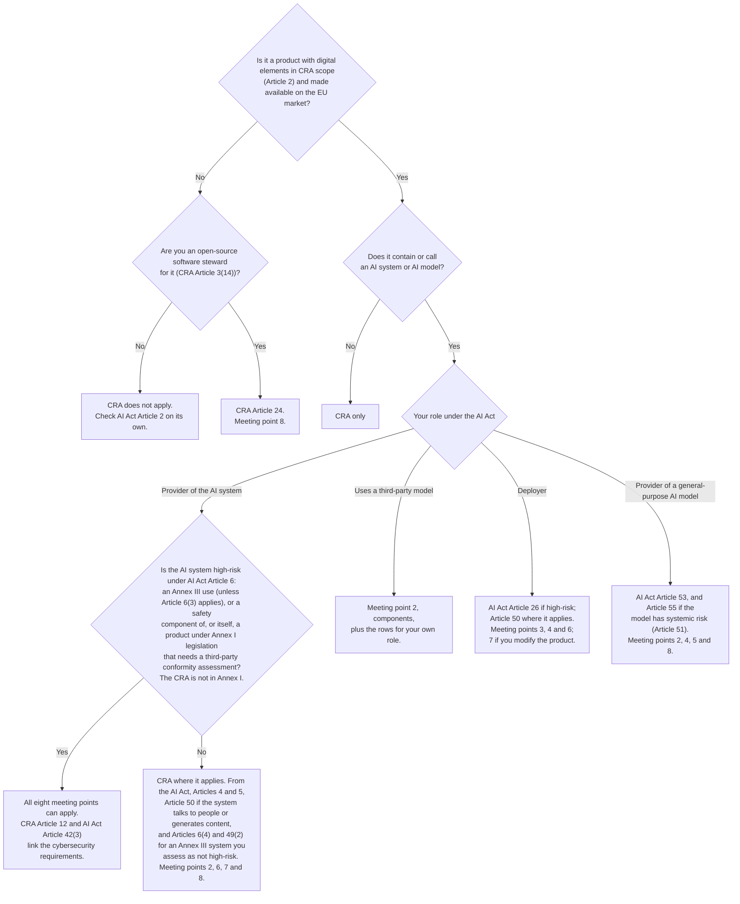

# White paper on AI Act and CRA compliance overlaps

## Abstract

This paper is for the compliance leads and engineers of a manufacturer that places a product with digital elements on the EU market when the product is, or contains, an AI system. That includes open source projects that do so in the course of a commercial activity. It answers one question: what must such a manufacturer show under the Cyber Resilience Act (CRA) and the AI Act, and where can one piece of evidence serve both?

For eight areas (cybersecurity requirements, components, recording activity, reporting, technical documentation, information to users, updates and changes, and open source) the paper gives the provision of each act, the role that holds the duty, the evidence that shows it was met and who can check that evidence. It gives the date from which each duty applies, and it marks where the texts let one document or procedure serve both acts and where they part. It ends with the questions the two texts leave open, as input to the Commission's guidance and to the harmonised standards.

The other roles appear only as the manufacturer meets them: the provider of a model it integrates, the deployer it writes instructions for, the steward of the open source software it depends on. The paper does not cover data protection, copyright beyond the duties of providers of general-purpose AI models, or the AI Act's fundamental rights impact assessment ([Art 27][ai27]). It is an orientation map, not a compliance checklist.

In brief:

- The CRA ties the two acts together in several provisions. Where its three conditions are met, a product that is a high-risk AI system is deemed to meet the cybersecurity requirements of AI Act [Art 15][ai15] ([Article 12(1)][cra12], [Art 42(3)][ai42]); accuracy and robustness stay outside that. The AI Act's conformity assessment procedure and its notified bodies then cover the CRA's requirements too ([Article 12(2)][cra12]), except for the important and critical products named in [Article 12(3)][cra12]. The product gets one set of technical documentation ([Article 31(3)][cra31]), one EU declaration of conformity ([Article 28(3)][cra28]), a cybersecurity risk assessment that can be part of the other act's ([Article 13(4)][cra13]) and one market surveillance authority ([Article 52(14)][cra52]).
- Everywhere else the acts run side by side, each with its own roles, triggers and clocks. A security event can start the CRA's 24-hour early warning and also be a serious incident under the AI Act, with a different deadline. A retrained model that fixes a vulnerability may be a security update under the CRA and can be a substantial modification under the AI Act.
- Five questions are left open by the texts, for example whether model weights are software under the CRA and whether a high-risk system may offer the CRA's logging opt-out.

This document does not constitute legal guidance; it reflects the current understanding of the CRA and the AI Act held by its contributors.

## Status of this document

This document is a draft and may be updated, replaced, or obsoleted at any time. It is inappropriate to cite this document as anything other than a work in progress. Publication of this draft does not imply endorsement by the Eclipse Foundation, the Open Regulatory Compliance Working Group, or any of its members or contributors.

This first draft was proposed to the AI Policy and Compliance SIG in [orcwg/orcwg#373][i373]. Its core is the table first proposed for the CRA FAQ in [orcwg/cra-hub#364][pr364], where reviewers asked for it to become a separate SIG deliverable. Comments are welcome on the pull request that adds this file.

## Introduction

The CRA ([Regulation (EU) 2024/2847][CRA]) sets cybersecurity requirements for products with digital elements. The AI Act ([Regulation (EU) 2024/1689][AI Act], as amended by the [Digital Omnibus on AI][omnibus], Regulation (EU) 2026/1744) sets requirements for AI systems and general-purpose AI models. The two acts were written separately and use different roles, different evidence and different authorities, but they link at several points. The clearest is [CRA Article 12][cra12], under which a high-risk AI system can meet the AI Act's cybersecurity requirement through the CRA.

Open source communities meet both acts at once, which is why the paper starts from the manufacturer. A library may ship a model, a manufacturer may integrate an open-weight model, and an open-source software steward may support a project that others build AI systems on. Each of them is the manufacturer or a party the manufacturer depends on. The SIG's [scope](../scope.md) covers how CRA obligations apply to AI. General CRA topics belong to the Cyber Resilience SIG, and this paper points to that SIG's work where the two overlap.

The SIG's starting question was "is CRA for models even possible?" (agenda of 7 and 21 September 2026). The short answer is that the CRA does not regulate a model on its own. It regulates the product with digital elements that ships the model, or that calls a model service the manufacturer designed and developed itself or has under its responsibility ([Article 3(2)][cra3]). A model service outside the manufacturer's responsibility is outside the CRA ([Recital 12][craR12]). The model then enters the CRA as a component of that product ([meeting point 2](#2-components-including-third-party-models)), through the manufacturer's risk assessment and due diligence. Whether the weights themselves are software is still open ([open question 1](#open-questions)).

### How to read this paper

There are four ways in:

1. **[Do both acts apply?](#do-both-acts-apply)** A decision diagram that routes you to the meeting points that matter.
2. **[From the CRA](#from-the-cra)**, the default. Start from a CRA article or Annex I requirement and find its AI Act counterpart.
3. **[From the AI Act](#from-the-ai-act)**. Start from an AI Act article and find its CRA counterpart.
4. **[By role](#by-role)**. Start from your own role, or from the role of a party you depend on or instruct.

Each route ends at one of the [eight meeting points](#the-meeting-points), where duties are split by role. The table cells are summaries. Whether a duty applies to a given product depends on the conditions in the cited provisions, so read the provision before relying on a cell.

### Terms

The two acts name their roles differently. The CRA speaks of manufacturers, importers, distributors, open-source software stewards and users. The AI Act speaks of providers, deployers, importers, distributors and providers of general-purpose AI models. One organisation often holds roles under both acts.

An AI model is not an AI system by itself. The AI Act's recitals say that models "do not constitute AI systems on their own" and need further components, such as a user interface, to become one. The CRA has no separate notion of a model. It knows software and hardware, and whether model weights count as software is one of the [open questions](#open-questions).

Both acts define "substantial modification", and the definitions differ. Under the CRA ([Article 3][cra3], point (30)) it turns on whether a change affects compliance with the essential cybersecurity requirements or modifies the intended purpose. The AI Act ([Art 3(23)][ai3]) has the same structure with a wider compliance target: the change affects compliance with all the high-risk requirements of Chapter III, Section 2, not only cybersecurity, or modifies the intended purpose, and it counts only if it was not foreseen or planned in the initial conformity assessment. [Meeting point 7](#7-updates-and-changes) shows where the two tests part.

"Deployer" is defined in the AI Act ([Art 3(4)][ai3]) and excludes personal, non-professional use. The CRA uses "user" without defining it as a role. A person who uses a product for a personal, non-professional purpose is a user under the CRA and not a deployer under the AI Act.

### Three levels: the model, the component and the product

The acts treat three different things that people call "an open-weights AI model" in practice. The text of this section comes from Juan Rico's review of this paper; the provisions cited were checked against the Official Journal texts.

| Level | What it is | CRA | AI Act |
|---|---|---|---|
| **1. Open-weights AI model** | Static files: trained parameters (weights), the architecture definition and the tokenizer and preprocessing files. No runtime and no interface; it cannot process inputs or produce outputs on its own | No text on models or weights. Software supplied outside a commercial activity is outside the CRA ([Article 2(1)][cra2], [Article 3(22)][cra3], [Recital 18][craR18]) | [Recital 97][aiR97]: a model is not an AI system and needs further components. [Art 3(63)][ai3]: defines the general-purpose AI model. [Art 53(2)][ai53] and [Recital 104][aiR104]: a model released under a free and open-source licence with public weights, architecture and usage information is exempt from Art 53(1)(a) and (b), unless it carries systemic risk ([Art 51][ai51]) |
| **2. Software component running an open-weights model** | Executable software that joins the weights to an inference engine, runtime libraries, memory management and local interfaces, so that it loads the weights, runs inference and processes inputs and outputs | A software component placed on the market separately is a product with digital elements ([Article 3(1)][cra3]). The steward regime applies to a steward that supports it ([Article 3(14)][cra3], [Article 24][cra24]). Free and open-source software supplied outside a commercial activity is excluded ([Article 2(1)][cra2], [Recital 18][craR18]), and a free and open-source component meant for integration by other manufacturers counts as made available only if its original manufacturer monetises it ([Recital 18][craR18]) | No category specific to an inference runtime or wrapper. [Recital 97][aiR97] separates the model from the system and [Art 3(1)][ai3] defines the system; [Art 25(4)][ai25] covers tools and components supplied to a high-risk system |
| **3. Product integrating the component** | A device, application or remote data processing service placed on the market for end users that combines the inference component, the weights, application logic, interfaces and connectivity | The finished product with digital elements and its manufacturer ([Article 3(1)][cra3], [Article 3(13)][cra3]). [Article 13(5)][cra13] governs integrating third-party components, free and open-source ones included. [Article 12(1)][cra12] covers products that are high-risk AI systems | The AI system and its provider ([Art 3(1) and 3(3)][ai3]). High-risk systems ([Art 6][ai6]) and their cybersecurity requirements ([Art 15][ai15]), linked to the CRA through [Article 12(1)][cra12] |

Duties follow the level. At level 1 the CRA has no text on models, and software supplied outside a commercial activity is outside it, so a freely supplied open-weights model carries no CRA manufacturer duties on the text as it stands (whether weights are software is an [open question](#open-questions)). If the model is a general-purpose AI model ([Art 3(63)][ai3]) it meets the AI Act's duties for such models, with the exemption above. At level 2 the CRA applies to the component when it is made available on the market in the course of a commercial activity, and the AI Act has no category for the runtime itself. At level 3 both acts can apply: the CRA to the finished product where it is in scope ([Article 2][cra2]), and the AI Act to the AI system, in full where the system is high-risk and in part otherwise ([Art 4, 5 and 50][ai50]). The manufacturer's due diligence on the level 2 component is the route by which the level 1 model enters the product ([meeting point 2](#2-components-including-third-party-models)).

## Do both acts apply?

The roles are not exclusive. A manufacturer that trains its own model and also uses a third-party one follows both branches.

## From the CRA

| CRA provision | What it asks | AI Act counterpart | Meeting point |
|---|---|---|---|
| [Annex I, Part I][craAI], [Article 12][cra12] | Cybersecurity properties of the product; for a high-risk AI system, deemed compliance with AI Act Art 15 cybersecurity on three conditions | [Art 15][ai15], [Art 42(3)][ai42], [Art 43][ai43] | [1](#1-cybersecurity-requirements) |
| [Article 13(5)][cra13], [Article 13(6)][cra13] | Due diligence on third-party components; report their vulnerabilities upstream | [Art 25(4)][ai25] (high-risk systems; not free and open-source tools or components other than general-purpose AI models), [Art 53(1)(b)][ai53] and Annex XII (general-purpose AI model providers; not open models without systemic risk) | [2](#2-components-including-third-party-models) |
| [Annex I, Part II][craAI] point (1), [Annex VII][craAVII] point 8 | Software bill of materials, at least the top-level dependencies, shown on reasoned request | No SBOM duty. Closest: Annex IV points 2(a) and 2(c), Annex XII, [Art 25(4)][ai25] | [2](#2-components-including-third-party-models) |
| [Annex I, Part I][craAI] point (2)(l) | Where the risk assessment makes it applicable, record and monitor relevant internal activity, with a user opt-out | [Art 12][ai12], [Art 19][ai19], [Art 21(2)][ai21], [Art 26(6)][ai26] | [3](#3-recording-activity) |
| [Article 14][cra14] | Report actively exploited vulnerabilities and severe incidents | [Art 73][ai73] (high-risk providers), [Art 26(5)][ai26] (high-risk deployers), [Art 55(1)(c)][ai55] (models with systemic risk) | [4](#4-reporting) |
| [Article 31][cra31], [Annex VII][craAVII], [Article 13(13)][cra13] | Technical documentation, and how long to keep it | [Art 11][ai11] and Annex IV, [Art 18][ai18], [Art 53(1)(a)][ai53] and Annex XI | [5](#5-technical-documentation) |
| [Article 13(18)][cra13], [Annex II][craAII] | Information and instructions to the user | [Art 13][ai13], [Art 50][ai50] | [6](#6-information-to-users) |
| [Annex I, Part II][craAI] points (7) and (8), [Article 22][cra22] | Security updates; who becomes the manufacturer after a substantial modification | [Art 43(4)][ai43], [Art 25(1)][ai25] | [7](#7-updates-and-changes) |
| [Article 24][cra24], [Article 25][cra25] | Open-source software stewards; voluntary security attestation | [Art 2(12)][ai2], [Art 53(2)][ai53] | [8](#8-open-source) |

## From the AI Act

| AI Act provision | What it asks | CRA counterpart | Meeting point |
|---|---|---|---|
| [Art 2(12)][ai2] | Excludes AI systems under free and open-source licences, unless high-risk or caught by Art 5 or 50 | [Article 24][cra24] | [8](#8-open-source) |
| [Art 11][ai11], Annex IV, [Art 18][ai18] | Technical documentation of a high-risk AI system, kept 10 years | [Article 31][cra31], including the single set of [Article 31(3)][cra31]; [Article 13(13)][cra13] | [5](#5-technical-documentation) |
| [Art 12][ai12], [Art 19][ai19], [Art 21(2)][ai21], [Art 26(6)][ai26] | Automatic logging; keeping the logs; access on reasoned request | [Annex I, Part I][craAI] point (2)(l) | [3](#3-recording-activity) |
| [Art 13][ai13], [Art 50][ai50] | Instructions for use to deployers; transparency to people | [Annex II][craAII] | [6](#6-information-to-users) |
| [Art 15][ai15], [Art 42(3)][ai42] | Accuracy, robustness and cybersecurity; cybersecurity deemed met through the CRA | [Article 12][cra12], [Annex I][craAI] | [1](#1-cybersecurity-requirements) |
| [Art 25][ai25] | Who becomes the provider; written agreements with suppliers | [Article 13(5)][cra13], [Article 22][cra22] | [2](#2-components-including-third-party-models), [7](#7-updates-and-changes) |
| [Art 43][ai43] | Conformity assessment; a new one after a substantial modification | [Article 12(2)][cra12], [Article 12(3)][cra12] | [1](#1-cybersecurity-requirements), [7](#7-updates-and-changes) |
| [Art 53][ai53], Annexes XI and XII | Duties of general-purpose AI model providers, and the open-source exception | [Article 13(5)][cra13], [Article 24][cra24] | [2](#2-components-including-third-party-models), [8](#8-open-source) |
| [Art 26(5)][ai26], [Art 55(1)(c)][ai55] (models with systemic risk only), [Art 73][ai73] | Serious incident reporting | [Article 14][cra14] | [4](#4-reporting) |

## By role

The first three rows are manufacturers. The others are the roles a manufacturer meets: the deployer it writes instructions for, the provider of a model it relies on, the steward of the software it integrates, and the person who uses its product.

| You are | CRA role | AI Act role | Meeting points |
|---|---|---|---|
| A maker of a product that is a high-risk AI system | Manufacturer | Provider | 1 to 8 |
| A maker of a product with an AI feature that is not high-risk | Manufacturer | Provider; Arts 4 and 5 apply, and Art 50 where it fits | 2, 6, 7, 8 |
| A maker that builds on someone else's model | Manufacturer | Provider of the AI system; downstream of the model provider | 2, and the rows above |
| An organisation that uses an AI system | User, unless it substantially modifies the product and makes it available on the market ([Article 22][cra22]) | Deployer: Art 26 for a high-risk system, with a fundamental rights impact assessment for some deployers ([Art 27][ai27]); Art 50 where it applies | 3, 4, 6, 7 |
| A provider of a general-purpose AI model | Manufacturer only if it places a product with digital elements on the market | Provider of a general-purpose AI model | 2, 4, 5, 8 |
| An open-source software steward | Steward ([Article 3(14)][cra3]) | None as steward | 8 |
| A person who uses the product, or is affected by it | User | Not a deployer when the use is personal and non-professional. [Art 50][ai50] requires providers to design systems that deal with people directly so that people are told it is an AI system, unless that is obvious. Anyone with grounds to consider that the AI Act has been infringed can complain to the market surveillance authority ([Art 85][ai85]). A person affected by a deployer's decision based on certain high-risk systems can ask the deployer for an explanation ([Art 86][ai86]) | 6 |

## The meeting points

The last column, "who can check it", names who can look at the evidence and from what. It is not a statement about who is legally responsible. For a product that is a high-risk AI system, the market surveillance authority designated under the AI Act is also its market surveillance authority under the CRA ([Article 52(14)][cra52]); for the systems the AI Office supervises, that is the AI Office ([Art 75(1)][ai75]).

### 1. Cybersecurity requirements

| Who | CRA | AI Act | Evidence | Who can check it |
|---|---|---|---|---|
| Manufacturer of a product that is a high-risk AI system | [Annex I, Part I][craAI] and Part II. [Article 12(1)][cra12]: the product is deemed to meet AI Act Art 15 cybersecurity if it meets Part I, the manufacturer's processes meet Part II, and the EU declaration of conformity demonstrates the level of protection Art 15 requires. AI Act [Art 42(3)][ai42] says the same | [Art 15(5)][ai15], resilience against attempts by unauthorised third parties to alter use, outputs or performance by exploiting system vulnerabilities | Cybersecurity risk assessment in the technical documentation; the EU declaration of conformity | Whoever the AI Act's [Art 43][ai43] procedure names ([Article 12(2)][cra12]): a notified body where Art 43 requires one; for most Annex III systems, internal control with no notified body. The market surveillance authority on reasoned request |
| Same, for important products under [Article 32(2)][cra32] points (a) and (b) or [Article 32(3)][cra32], or critical products that must obtain a European cybersecurity certificate ([Article 8(1)][cra8]) or, absent one, follow [Article 32(3)][cra32], where AI Act internal control applies | [Article 12(3)][cra12]: the CRA's own conformity procedures, for the cybersecurity requirements | Annex VI internal control for the rest | Same | The body or scheme the CRA procedure names |
| Manufacturer of a product whose AI feature is not high-risk | [Annex I][craAI] in full | Art 15 does not apply | CRA documentation only | CRA route only |

The deemed compliance covers the cybersecurity part of Art 15 only, not accuracy or robustness. [Recital 51][craR51] says the CRA risk assessment should take into account AI-specific vulnerabilities such as data poisoning or adversarial attacks, and the three conditions of Article 12(1) are the route to the deemed compliance. It supports a claim about the product. It does not show that a control worked in any particular run.

### 2. Components, including third-party models

The CRA's duties depend on who is responsible for the model, not where it runs. A cloud model designed and developed by the manufacturer or under its responsibility, without which the product cannot perform one of its functions, is part of the product as remote data processing ([Article 3(2)][cra3]). A third-party cloud API outside the manufacturer's responsibility is not.

| Model origin | CRA | AI Act | Evidence | Who can check it |
|---|---|---|---|---|
| Trained or fine-tuned by the manufacturer | Part of the product; [Annex I][craAI] applies directly. On one reading, the base model of a fine-tune is a component sourced from a third party ([Article 13(5)][cra13]); the CRA does not say so, and the open question below applies | The manufacturer is the provider of the AI system | Technical documentation; an SBOM that names the model | The market surveillance authority, on reasoned request where it needs the SBOM to check Annex I ([Annex VII][craAVII] point 8) |
| A third-party model, integrated as is | [Article 13(5)][cra13] due diligence; if the model counts as a component, a top-level dependency in the SBOM ([Annex I, Part II][craAI] point (1)); vulnerabilities found go to its maintainer ([Article 13(6)][cra13]) | From a general-purpose model provider, the [Art 53(1)(b)][ai53] and Annex XII information. For a high-risk system, a written agreement with the supplier of the model ([Art 25(4)][ai25]) | The SBOM; the due diligence record; the Annex XII information; the agreement | The downstream provider, for Annex XII. The market surveillance authority, on reasoned request, for the SBOM; it cannot tell from the SBOM whether anyone looked for models |
| A component or service that uses a model (a local library or a third-party cloud API) | On this paper's reading: for a local library, [Article 13(5)][cra13] due diligence, including which model it uses, and an SBOM entry. For a third-party cloud API, due diligence and the SBOM cover the client SDK, and the risk assessment ([Article 13(2)][cra13]) covers the call to the service | The manufacturer is the provider of the AI system it builds on the component or service, and of a high-risk one if the use is listed in Annex III and [Art 6(3)][ai6] does not take it out, whoever hosts the model | The SBOM; the due diligence record; the risk assessment | As above |

An SBOM can name a model and its lineage ([G7 SBOM for AI minimum elements][G7 SBOM]). The CRA sets the SBOM minimum at top-level dependencies; its duty to identify and document components is wider, but no text says which classes of component to look for. The formats cannot yet say which classes of component were looked for ([CycloneDX #1159][cdx1159], [SPDX 3 #1105][spdx1105]). So a missing model entry does not show whether there is no model or nobody looked. In practice SBOM tools read manifests and lock files, so a model loaded in code is often missing.

This matters most after an incident. If an integrated model is found to be backdoored and the flaw is exploited, the manufacturer has 24 hours for an early warning ([meeting point 4](#4-reporting)) and first has to find which of its products ship that model.

Open question: the CRA defines software as computer code ([Article 3(4)][cra3]). Whether model weights count is not settled. Some weight formats run code when loaded. The SBOM implementing act under [Article 13(24)][cra13] could settle it.

### 3. Recording activity

| Who | CRA | AI Act | Evidence | Who can check it |
|---|---|---|---|---|
| Manufacturer | [Annex I, Part I][craAI] point (2)(l): the product records and monitors relevant internal activity, with an opt-out for the user, where the risk assessment calls for it | Nothing, unless the system is high-risk | The technical documentation and tests showing the capability; at run time, the records on the product | The user, for the records; the market surveillance authority, for the capability |
| Provider of a high-risk AI system | Same | [Art 12][ai12]: automatic logging over the lifetime. [Art 19(1)][ai19]: keep logs at least six months, unless other Union or national law provides otherwise. [Art 21(2)][ai21]: give access on reasoned request | The logs | The competent authority, on reasoned request, sees the logs as the provider holds them |
| Deployer of a high-risk AI system | User | [Art 26(6)][ai26]: keep logs at least six months, unless other Union or national law provides otherwise | The logs | The competent authorities, through the deployer's duty to cooperate ([Art 26(12)][ai26]) |

Arts 19(1), 21(2) and 26(6) all apply "to the extent such logs are under their control", and neither act asks the holder to show that the logs are complete and unaltered. An outside check is possible where a reference to the logs was kept somewhere the holder does not control, such as a hash recorded with a third party; neither act requires one. [Q5 in the draft AI questions for the CRA FAQ][q5] lists event classes worth recording.

### 4. Reporting

| Who | CRA | AI Act | Evidence | Who can check it |
|---|---|---|---|---|
| Manufacturer | [Article 14][cra14]: actively exploited vulnerabilities and severe incidents, to the coordinating CSIRT and ENISA through the single reporting platform. Early warning within 24 hours, notification within 72 hours, final report within 14 days after a corrective or mitigating measure is available (vulnerabilities) or one month of the notification (incidents). Impacted users are informed ([Article 14(8)][cra14]) | Nothing, unless the system is high-risk | The notifications | The CSIRT and ENISA, from what they receive; the market surveillance authority supervises compliance ([Article 52(4)][cra52]) |
| Provider of a high-risk AI system | Same | [Art 73][ai73]: serious incidents, immediately once a causal link is established or reasonably likely, and at most 15 days after becoming aware; 10 days after a death; 2 days for a widespread infringement or a serious and irreversible disruption of critical infrastructure. To the market surveillance authority where the incident occurred, or to the AI Office for systems it supervises ([Art 75(1a)][ai75]) | The notifications; the investigation ([Art 73(6)][ai73]) | The receiving authority, which can investigate further |
| Deployer of a high-risk AI system | User | [Art 26(5)][ai26]: immediately inform the provider, then the importer or distributor and the market surveillance authority | The notice | Same |
| Provider of a general-purpose AI model with systemic risk | Only if it is also a manufacturer | [Art 55(1)(c)][ai55]: to the AI Office and, as appropriate, national competent authorities | The notice | The AI Office |

The two routes run side by side. CRA Article 14 covers security: actively exploited vulnerabilities and severe incidents that affect the security of the product. AI Act Art 73 covers serious incidents, such as harm to health, critical infrastructure, fundamental rights or property. One event can trigger both. Neither act asks a report to attach evidence that a third party could check against the event. [Art 73(9)][ai73] and (10) narrow the AI Act notification for providers that already have equivalent reporting duties under other Union law and for medical devices.

### 5. Technical documentation

| Who | CRA | AI Act | Evidence | Who can check it |
|---|---|---|---|---|
| Manufacturer | [Article 31][cra31] and [Annex VII][craAVII]; kept 10 years or the support period, whichever is longer ([Article 13(13)][cra13]). Micro and small enterprises may use a simplified format ([Article 33(5)][cra33]) | Nothing, unless high-risk | Technical documentation | Notified body, where the procedure uses one; market surveillance authority on reasoned request |
| Manufacturer of a product that is a high-risk AI system | [Article 31(3)][cra31]: one set of documentation, with the CRA and AI Act content | [Art 11][ai11] and Annex IV; kept 10 years ([Art 18][ai18]). SMEs and small mid-caps may use a simplified form | One combined set | Same |
| Provider of a general-purpose AI model | Only if it is also a manufacturer | [Art 53(1)(a)][ai53] and Annex XI, for the AI Office on request | Model documentation | The AI Office and national competent authorities |

The single set comes from the CRA, [Article 31(3)][cra31], and only for products under [Article 12][cra12]. AI Act [Art 11(2)][ai11] gives a single set for products under the legislation in its Annex I Section A, which does not list the CRA. The simplified forms differ: the CRA's is for micro and small enterprises, the AI Act's also for medium-sized enterprises and small mid-caps.

### 6. Information to users

| Who | CRA | AI Act | Evidence | Who can check it |
|---|---|---|---|---|
| Manufacturer | [Article 13(18)][cra13] and [Annex II][craAII], among other items: contact point for vulnerabilities, end of the support period, how to install updates, where applicable how to turn off automatic updates, and optionally where to find the SBOM | Nothing, unless one of the rows below applies | The user information | The user, that it is there and readable; the market surveillance authority, that it is accurate |
| Provider of a high-risk AI system | Same | [Art 13][ai13]: instructions for use for the deployer | Instructions for use | The deployer, that they are there; the market surveillance authority, against the technical documentation |
| Provider or deployer of certain AI systems | Same | [Art 50][ai50]: providers tell people they are interacting with an AI system and mark generated content in a machine-readable way; deployers disclose emotion recognition, biometric categorisation, deep fakes and AI-generated text published to inform the public on matters of public interest | The notice or marking | The person, for a notice; a detection tool, for a machine-readable marking; the market surveillance authority |

### 7. Updates and changes

| Who | CRA | AI Act | Evidence | Who can check it |
|---|---|---|---|---|
| Manufacturer | Security updates for the support period ([Annex I, Part II][craAI] points (7) and (8)), kept available for at least 10 years or the rest of the support period, whichever is longer ([Article 13(9)][cra13]). A security update that lowers the risk without changing the intended purpose is not a substantial modification ([Recital 39][craR39]) | For a high-risk system, a substantial modification ([Art 3(23)][ai3]) needs a new conformity assessment ([Art 43(4)][ai43]). Changes a learning system was designed to make, and documented in Annex IV point 2(f), are not one | Update records; the documented planned changes | Notified body, where the procedure uses one; market surveillance authority |
| Someone else who modifies the product | Becomes the manufacturer if it substantially modifies the product and makes it available on the market ([Article 22][cra22]) | Becomes the provider if it substantially modifies a high-risk system, or changes a system's intended purpose so that it becomes high-risk ([Art 25(1)][ai25]), even if it keeps using the system itself ([Art 43(4)][ai43]) | Their own documentation | Same |

Two differences matter here. A deployer that substantially modifies a high-risk system for its own use becomes a provider under the AI Act but stays a user under the CRA. And a retrained model that fixes a vulnerability may be a security update under the CRA ([Recital 39][craR39]) if the intended purpose does not change, though the CRA text does not address retraining, while under the AI Act it can be a substantial modification. For a system that keeps learning, changes documented in advance under Annex IV point 2(f) do not count. The CRA asks instead whether the change affects compliance with Part I of Annex I or changes the intended purpose ([Article 3(30)][cra3]), and [Recital 39][craR39] adds that an unforeseen change of purpose, a changed hazard or a higher cybersecurity risk make it substantial. Whether a planned security retraining can be documented under Annex IV point 2(f) is not settled.

### 8. Open source

| Who | CRA | AI Act | Evidence | Who can check it |
|---|---|---|---|---|
| Open-source software steward | [Article 24][cra24]: a cybersecurity policy documented in a verifiable manner. [Article 14(1)][cra14] applies to the extent it is involved in development; [Article 14(3)][cra14] and (8) to the extent a severe incident affects the systems it provides for development ([Article 24(3)][cra24]) | None as steward | The policy | The market surveillance authority, on reasoned request ([Article 24(2)][cra24]) |
| Manufacturer that integrates open source | [Article 13(5)][cra13] due diligence; report vulnerabilities upstream ([Article 13(6)][cra13]) | [Art 25(4)][ai25] does not require written agreements with suppliers of free and open-source tools or components, except general-purpose AI models | The library's public development record: history, issue tracker, advisories; the manufacturer's due diligence record | Anyone, for the public record; the market surveillance authority, for the due diligence record |
| Provider of an AI system under a free and open-source licence | Manufacturer only if it makes the product available in the course of a commercial activity | Out of scope ([Art 2(12)][ai2]), unless high-risk or caught by Art 5 or Art 50 | As the role requires | As the role requires |
| Provider of a general-purpose AI model released under a free and open-source licence, with public weights, architecture and usage information | Only if it is also a manufacturer | [Art 53(2)][ai53] waives Art 53(1)(a) and (b), the model documentation and the downstream information, but not (c) and (d), the copyright policy and the training content summary. [Art 54(6)][ai54] also waives the authorised representative. Neither waiver covers models with systemic risk | Public weights, architecture and usage information; the copyright policy; the training content summary | Anyone, for what is published; the AI Office, for (c) and (d) |

An integrator can study an open-source library from its public development record, with or without a steward. For an exempt open-weight model it has the weights, the architecture, the usage information and the training content summary, but not the documentation of how the model was trained and evaluated. Nothing in the CRA requires a steward to publish its policy or to say that it is a steward. [Article 25][cra25] empowers the Commission to set up voluntary security attestation programmes, which would be the CRA's route for making that kind of evidence available to integrators once a delegated act does so. The AI Act has no voluntary attestation programme for open-weight models.

## When each part applies

This section groups the dates by case and by profile. The dates come from the Official Journal texts: CRA [Articles 69][cra69] and [71][cra71], and AI Act Articles 57(1), 111 and 113 as amended by the [Digital Omnibus on AI][omnibus].

### By case

| Case | CRA | AI Act |
|---|---|---|
| **Open-weights model released by its provider** (level 1) | Applies only if the model counts as software (an [open question](#open-questions)) and is made available in the course of a commercial activity ([Article 3(22)][cra3], [Recital 18][craR18]) | For general-purpose AI models placed on the market from 2 August 2025, with the open-source exemption of [Art 53(2)][ai53]; models placed on the market before that date have until 2 August 2027 ([Art 111(3)][omnibus]) |
| **Component running a model, placed on the market separately** (level 2) | Applies from 11 December 2027. [Article 14][cra14] reporting applies from 11 September 2026. Stewards: [Article 24][cra24] | No category of its own, apart from the supplier duty of [Art 25(4)][ai25] when the component is integrated in a high-risk system |
| **Product with an AI feature that is not high-risk** (level 3) | Applies from 11 December 2027; [Article 14][cra14] reporting from 11 September 2026 | The prohibitions in Art 5 (other than the new points (ba) and (bb)) and AI literacy have applied since 2 February 2025. [Art 50][ai50] has applied since 2 August 2026, and providers of generative systems placed on the market before that date have until 2 December 2026 to comply with [Art 50(2)][ai50] ([Art 111(4)][omnibus]) |
| **Product that is a high-risk AI system** (level 3) | Applies from 11 December 2027; [Article 12][cra12] links it to AI Act Art 15 | High-risk requirements apply from 2 December 2027 for Annex III systems and from 2 August 2028 for Annex I systems |
| **Product already on the market before those dates** | Falls under the CRA only after a substantial modification from 11 December 2027, but [Article 14][cra14] reporting applies to it from 11 September 2026 ([Article 69][cra69]) | A high-risk system placed on the market before the date its requirements apply falls under the AI Act only if its design changes significantly from that date ([Art 111(2)][omnibus]); systems intended for use by public authorities must comply by 2 August 2030, and the prohibitions of Art 5 apply regardless |

### By profile

| Profile | Applies from |
|---|---|
| Manufacturer | CRA: 11 December 2027, with [Article 14][cra14] reporting from 11 September 2026. The CRA's rules on notified bodies (Chapter IV) have applied since 11 June 2026 |
| Provider of an AI system | Prohibitions (other than Art 5(1)(ba) and (bb), from 2 December 2026) and AI literacy since 2 February 2025; [Art 50][ai50] since 2 August 2026; high-risk duties from 2 December 2027 (Annex III) or 2 August 2028 (Annex I) |
| Deployer | AI literacy and the prohibitions on use since 2 February 2025 (new prohibitions (ba) and (bb) from 2 December 2026); the same dates as the provider for high-risk systems; [Art 50][ai50] where it applies |
| Provider of a general-purpose AI model | Since 2 August 2025 for models placed on the market from that date; 2 August 2027 for models placed before it ([Art 111(3)][omnibus]) |
| Open-source software steward | CRA [Article 24][cra24], from 11 December 2027. [Article 14][cra14] itself applies from 11 September 2026 ([Article 71(2)][cra71]); [Article 24(3)][cra24] extends Article 14(1), (3) and (8) to stewards, and the Regulation does not say whether that extension runs from 11 September 2026 or from 11 December 2027 |

### Dates the Digital Omnibus on AI moved

Four of the dates that the [Digital Omnibus on AI][omnibus] sets or moves matter here:

- the new prohibitions in Art 5(1)(ba) and (bb), with Art 5(1a) and (1b), apply from 2 December 2026;
- providers of generative systems placed on the market before 2 August 2026 must take the necessary steps to comply with Art 50(2) by 2 December 2026 ([Art 111(4)][omnibus]);
- each Member State must have at least one national AI regulatory sandbox ([Art 57(1)][omnibus]) operational by 2 August 2027, moved from 2 August 2026;
- the high-risk requirements apply from 2 December 2027 for Annex III systems and from 2 August 2028 for Annex I systems.

## Open questions

Each of these is a point where the texts do not settle the answer. The meeting points above flag them where they arise.

1. **Model weights as software.** The CRA defines software as computer code ([Article 3][cra3], point (4)). Whether model weights count is not settled, and some weight formats run code when they are loaded. The implementing act on the SBOM under [Article 13(24)][cra13] could settle it.
2. **The user's opt-out and mandatory logs.** [Annex I, Part I][craAI] point (2)(l) asks for recording of internal activity "with an opt-out mechanism for the user". For a high-risk AI system, AI Act [Art 12(1)][ai12] requires the system to "technically allow for the automatic recording of events" over its lifetime, and [Art 26(6)][ai26] asks deployers to keep the logs. Whether a high-risk system may offer the CRA opt-out, and for which records, is not settled. Commission guidance under [CRA Article 26][cra26] or [AI Act Art 96][ai96] could address it.
3. **Equivalent reporting.** For Annex III high-risk systems whose providers already have "reporting obligations equivalent" to the AI Act's under other Union law, [Art 73(9)][ai73] limits the AI Act notification to incidents under Art 3(49)(c). Whether CRA [Article 14][cra14] is such an obligation is not stated. Its triggers are security events, not the AI Act's serious incidents, which points against it.
4. **Nine days in December 2027.** The AI Act's high-risk duties for Annex III systems apply from 2 December 2027, and the CRA from 11 December 2027 ([Article 71][cra71]). Products placed on the market before 11 December 2027 fall under the CRA's requirements, other than Article 14, only after a substantial modification ([Article 69][cra69]). Neither text says what a provider of a product placed in that window can rely on from the CRA side while the route of [Article 12][cra12] is not yet available to it. The AI Act's own routes remain open to it ([Art 40][ai40], [Art 42(2)][ai42], [Art 43][ai43]).
5. **Security retraining.** Whether a planned security retraining can be documented in advance under AI Act Annex IV point 2(f), so that it is not a substantial modification, is not settled ([meeting point 7](#7-updates-and-changes)).

## What the next revisions need

The SIG's discussions since September raised these questions. This paper does not answer them. Each is a question for the Commission's guidance and the harmonised standards, and the SIG's part is to put it to them.

1. **Integrity of a model you cannot inspect.** A backdoor planted through training data is "computationally impossible to find without access to the training data" ([CISA, open source software security principles][cisa oss], August 2026). It shows itself only when it is triggered, and the weights alone do not reveal it. So the evidence for an integrated model moves from scanning the model to recording what it does: the run-time records of meeting point 3, and repeat evaluations against a fixed test set. Neither act says what a repeat-evaluation record for an integrated model should hold. The AI Act lists the content of testing records for a high-risk system's technical documentation (Annex IV point 2(g)) and for a general-purpose model with systemic risk (Annex XI, Section 2), and the CRA lists none.
2. **Replacing a model, and models behind an endpoint.** A product can swap its model, or call one that a provider changes behind a stable name, with nothing in the build. A record made before the swap could state the capability apart from any model, a pass threshold for each metric, and a digest of the evaluation set, with a held-out part kept by an assessor. A later run is then checked against that record. For a hosted endpoint, the record can bind the requests, the responses, the time and the score, but not the identity of the model. The SIG should say which of these a manufacturer's [Article 13(5)][cra13] due diligence can rely on.
3. **Edits to the weights.** A small edit to a model's weights can change its behaviour with no new training. The Commission's guidelines for general-purpose AI model providers treat a modifier as a provider above an indicative one third of the original training compute, so such an edit leaves the duties with the original provider. In a high-risk system the same edit can be a substantial modification ([meeting point 7](#7-updates-and-changes)). Neither act asks for the weight difference itself, and the SIG could ask that it be kept.
4. **Logs an outsider can check.** The AI Act gives an authority the logs "to the extent such logs are under their control" (Arts 19(1), 21(2) and 26(6)). The CRA gives it the documentation and data it needs to assess conformity ([Article 13(22)][cra13], [Article 53][cra53]) and has no rule on logs. In both, the authority reads what the holder keeps ([meeting point 3](#3-recording-activity)). The next draft should say what makes a log export checkable by someone who does not trust its holder, for example a reference kept with a third party at the time of recording.
5. **One event, two reports.** A single incident can trigger CRA [Article 14][cra14] and AI Act [Art 73][ai73] ([meeting point 4](#4-reporting)). A shared record of the event, from which both notices are written, would let the receiving authorities compare them.
6. **Standards.** The harmonised standards for both acts are still being drafted. The [minutes of 2 November][min1102] record that two CENELEC standards for the AI Act, on logging and on risk, were rejected internally in CENELEC. The SIG can feed this paper's meeting points into the next drafts of both, so that a single test can show conformity under both acts.

Once a standard states what a record must show, a shared, versioned set of test cases that projects run in their own CI would let a manufacturer show an authority that its records meet that check. The [Specifications and tools](#specifications-and-tools) list gives examples, none of them required by either act.

## Planned sections

The next draft adds these sections. Owners are to be agreed at the SIG call.

- **Risk management.** CRA [Article 13][cra13] paragraphs (2) and (3), read with [Recital 51][craR51]; AI Act [Art 9][ai9], whose paragraph 10 lets its risk management be combined with procedures required by "other relevant provisions of Union law".
- **Quality management and post-market monitoring.** The vulnerability handling requirements in CRA [Annex I, Part II][craAI]; AI Act [Art 17][ai17] and [Art 72][ai72].
- **Declaration of conformity and CE marking.** CRA [Article 28][cra28], whose paragraph 3 asks for a single EU declaration of conformity where several Union acts require one, and [Article 30][cra30]; AI Act [Art 47][ai47] and [Art 48][ai48]. Under [Article 12(1)][cra12], the CRA declaration is where the Art 15 level of protection is demonstrated.
- **Market surveillance and penalties.** CRA [Article 52][cra52] and [Article 64][cra64]; AI Act [Art 74][ai74] and [Art 99][ai99].
- **Standards and guidance.** Presumption of conformity under CRA [Article 27][cra27] and AI Act [Art 40][ai40]; the Commission guidance under CRA [Article 26][cra26] and AI Act [Art 96][ai96]; and the state of the harmonised standards for each act.

## Specifications and tools

These are examples, not requirements. Neither act names a tool for the points below, and neither names a file format for them, except that the AI Act has the AI Office provide a template for the training content summary ([Art 53(1)(d)][ai53]).

- **Describing models in an SBOM:** [CycloneDX ML-BOM][mlbom] and the [SPDX 3 AI profile][spdxai].
- **Finding models used in code:** [AIBoMGen][aibomgen] finds Hugging Face models and datasets used in code and writes a CycloneDX AI bill of materials.
- **Testing a log store, and checking an open-weight release:** two [guides][guides] with test cases, installed as a pinned package (`pip install agent-evidence-vectors==0.38.0`) or run in CI as a GitHub Action (`uses: probityai/agent-evidence-vectors@v0.38.0`). The first checks whether a log store shows deleted, reordered or replayed records, which a check of signatures alone misses. A pass shows that the history was not changed after a reference to it was kept elsewhere. It does not show that the log was complete. The second checks whether a model release record carries what [Art 53(2)][ai53] makes a condition of its exemption: an open licence and public weights, architecture information and usage information. It reads the release record and fetches nothing.
- **Checking a statement against records:** [agent-evidence-verify][pverify] (`pip install agent-evidence-verify==0.10.0`) checks whether a claim, such as a sentence in a report, is supported by the records it cites, and keeps the decision so that someone else can replay it.

## References

1. Regulation (EU) 2024/2847 (Cyber Resilience Act), [Official Journal][CRA].
1. Regulation (EU) 2024/1689 (AI Act), [Official Journal][AI Act].
1. Regulation (EU) 2026/1744 (Digital Omnibus on AI), [Official Journal][omnibus].
1. CISA, [Open source software security principles and practices][cisa oss], August 2026.
1. G7 Cybersecurity Working Group, [SBOM for AI: Minimum Elements][G7 SBOM], 2026.
1. CISA, [2026 Minimum Elements for a Software Bill of Materials][cisa sbom].
1. [CycloneDX ML-BOM][mlbom] and [SPDX 3.0.1 AI profile][spdxai].
1. [CycloneDX/specification#1159][cdx1159] and [spdx/spdx-3-model#1105][spdx1105], on declaring what an SBOM covers.
1. [orcwg/cra-hub#364][pr364], the table this paper grew from, and [orcwg/cra-hub#353][q5], the AI questions for the CRA FAQ.
1. [orcwg/orcwg#373][i373], the deliverable proposal.

## Acknowledgments

The following individuals have contributed to this document, either directly or indirectly (e.g. by drafting, reviewing, or raising questions):

- Sankalp Gilda
- Ciarán O'Riordan
- Juan Rico (Eclipse Foundation)
- Javier Valiño (Eclipse Foundation)
- Lukas Kahwe Smith
- Wiebe Vandendriessche (IDLab, Ghent University - imec)
- Tobie Langel (UnlockOpen)

If you have contributed to this document and are not properly acknowledged, or if you want to edit or remove your name, please let us know by [opening an issue](https://github.com/orcwg/orcwg/issues/new) and we will address it promptly.

---

## About the ORC Working Group

The Open Regulatory Compliance Working Group (ORC WG) brings together prominent open source foundations, leading global enterprises, and industry stakeholders to address the growing impact of software regulations on open source. With over 65 members and growing, ORC develops best practices, specifications, and practical resources to help organizations navigate evolving regulatory requirements. Its initial focus is on the European Cyber Resilience Act (CRA), while supporting the long-term security, sustainability, and adoption of open source innovation worldwide.

For more information, visit [orcwg.org](https://orcwg.org).

[CRA]: https://eur-lex.europa.eu/eli/reg/2024/2847/oj
[i373]: https://github.com/orcwg/orcwg/issues/373
[pr364]: https://github.com/orcwg/cra-hub/pull/364
[cisa sbom]: https://www.cisa.gov/resources-tools/resources/2026-minimum-elements-software-bill-materials-sbom
[pverify]: https://github.com/probityai/probity/tree/main/packages/agent-evidence-verify
[cisa oss]: https://www.cisa.gov/sites/default/files/2026-08/open-source-software-security-principles-and-practices.pdf
[cra26]: https://eur-lex.europa.eu/legal-content/EN/TXT/HTML/?uri=CELEX:32024R2847#art_26
[cra27]: https://eur-lex.europa.eu/legal-content/EN/TXT/HTML/?uri=CELEX:32024R2847#art_27
[cra28]: https://eur-lex.europa.eu/legal-content/EN/TXT/HTML/?uri=CELEX:32024R2847#art_28
[cra30]: https://eur-lex.europa.eu/legal-content/EN/TXT/HTML/?uri=CELEX:32024R2847#art_30
[cra64]: https://eur-lex.europa.eu/legal-content/EN/TXT/HTML/?uri=CELEX:32024R2847#art_64
[ai9]: https://eur-lex.europa.eu/legal-content/EN/TXT/HTML/?uri=CELEX:32024R1689#art_9
[ai17]: https://eur-lex.europa.eu/legal-content/EN/TXT/HTML/?uri=CELEX:32024R1689#art_17
[ai40]: https://eur-lex.europa.eu/legal-content/EN/TXT/HTML/?uri=CELEX:32024R1689#art_40
[ai47]: https://eur-lex.europa.eu/legal-content/EN/TXT/HTML/?uri=CELEX:32024R1689#art_47
[ai48]: https://eur-lex.europa.eu/legal-content/EN/TXT/HTML/?uri=CELEX:32024R1689#art_48
[ai72]: https://eur-lex.europa.eu/legal-content/EN/TXT/HTML/?uri=CELEX:32024R1689#art_72
[ai74]: https://eur-lex.europa.eu/legal-content/EN/TXT/HTML/?uri=CELEX:32024R1689#art_74
[ai96]: https://eur-lex.europa.eu/legal-content/EN/TXT/HTML/?uri=CELEX:32024R1689#art_96
[ai99]: https://eur-lex.europa.eu/legal-content/EN/TXT/HTML/?uri=CELEX:32024R1689#art_99
[AI Act]: https://eur-lex.europa.eu/eli/reg/2024/1689/oj
[omnibus]: https://eur-lex.europa.eu/eli/reg/2026/1744/oj
[ai2]: https://eur-lex.europa.eu/legal-content/EN/TXT/HTML/?uri=CELEX:32024R1689#art_2
[ai3]: https://eur-lex.europa.eu/legal-content/EN/TXT/HTML/?uri=CELEX:32024R1689#art_3
[ai11]: https://eur-lex.europa.eu/legal-content/EN/TXT/HTML/?uri=CELEX:32024R1689#art_11
[ai12]: https://eur-lex.europa.eu/legal-content/EN/TXT/HTML/?uri=CELEX:32024R1689#art_12
[ai13]: https://eur-lex.europa.eu/legal-content/EN/TXT/HTML/?uri=CELEX:32024R1689#art_13
[ai15]: https://eur-lex.europa.eu/legal-content/EN/TXT/HTML/?uri=CELEX:32024R1689#art_15
[ai18]: https://eur-lex.europa.eu/legal-content/EN/TXT/HTML/?uri=CELEX:32024R1689#art_18
[ai19]: https://eur-lex.europa.eu/legal-content/EN/TXT/HTML/?uri=CELEX:32024R1689#art_19
[ai21]: https://eur-lex.europa.eu/legal-content/EN/TXT/HTML/?uri=CELEX:32024R1689#art_21
[ai25]: https://eur-lex.europa.eu/legal-content/EN/TXT/HTML/?uri=CELEX:32024R1689#art_25
[ai26]: https://eur-lex.europa.eu/legal-content/EN/TXT/HTML/?uri=CELEX:32024R1689#art_26
[ai42]: https://eur-lex.europa.eu/eli/reg/2026/1744/oj
[ai27]: https://eur-lex.europa.eu/legal-content/EN/TXT/HTML/?uri=CELEX:32024R1689#art_27
[ai43]: https://eur-lex.europa.eu/legal-content/EN/TXT/HTML/?uri=CELEX:32024R1689#art_43
[ai50]: https://eur-lex.europa.eu/legal-content/EN/TXT/HTML/?uri=CELEX:32024R1689#art_50
[ai53]: https://eur-lex.europa.eu/legal-content/EN/TXT/HTML/?uri=CELEX:32024R1689#art_53
[ai54]: https://eur-lex.europa.eu/legal-content/EN/TXT/HTML/?uri=CELEX:32024R1689#art_54
[ai55]: https://eur-lex.europa.eu/legal-content/EN/TXT/HTML/?uri=CELEX:32024R1689#art_55
[ai73]: https://eur-lex.europa.eu/legal-content/EN/TXT/HTML/?uri=CELEX:32024R1689#art_73
[ai75]: https://eur-lex.europa.eu/eli/reg/2026/1744/oj
[ai85]: https://eur-lex.europa.eu/legal-content/EN/TXT/HTML/?uri=CELEX:32024R1689#art_85
[ai86]: https://eur-lex.europa.eu/legal-content/EN/TXT/HTML/?uri=CELEX:32024R1689#art_86
[G7 SBOM]: https://www.bsi.bund.de/SharedDocs/Downloads/EN/BSI/KI/SBOM-for-AI_minimum-elements.pdf?__blob=publicationFile&v=4
[cdx1159]: https://github.com/CycloneDX/specification/issues/1159
[spdx1105]: https://github.com/spdx/spdx-3-model/issues/1105
[q5]: https://github.com/orcwg/cra-hub/pull/353
[aibomgen]: https://github.com/idlab-discover/aibomgen-cli
[mlbom]: https://cyclonedx.org/capabilities/mlbom/
[spdxai]: https://spdx.github.io/spdx-spec/v3.0.1/model/AI/AI/
[guides]: https://github.com/probityai/agent-evidence-vectors/tree/main/docs/guides
[cra12]: https://eur-lex.europa.eu/legal-content/EN/TXT/HTML/?uri=CELEX:32024R2847#art_12
[cra13]: https://eur-lex.europa.eu/legal-content/EN/TXT/HTML/?uri=CELEX:32024R2847#art_13
[cra14]: https://eur-lex.europa.eu/legal-content/EN/TXT/HTML/?uri=CELEX:32024R2847#art_14
[cra22]: https://eur-lex.europa.eu/legal-content/EN/TXT/HTML/?uri=CELEX:32024R2847#art_22
[cra24]: https://eur-lex.europa.eu/legal-content/EN/TXT/HTML/?uri=CELEX:32024R2847#art_24
[cra25]: https://eur-lex.europa.eu/legal-content/EN/TXT/HTML/?uri=CELEX:32024R2847#art_25
[cra3]: https://eur-lex.europa.eu/legal-content/EN/TXT/HTML/?uri=CELEX:32024R2847#art_3
[cra31]: https://eur-lex.europa.eu/legal-content/EN/TXT/HTML/?uri=CELEX:32024R2847#art_31
[cra32]: https://eur-lex.europa.eu/legal-content/EN/TXT/HTML/?uri=CELEX:32024R2847#art_32
[cra33]: https://eur-lex.europa.eu/legal-content/EN/TXT/HTML/?uri=CELEX:32024R2847#art_33
[cra53]: https://eur-lex.europa.eu/legal-content/EN/TXT/HTML/?uri=CELEX:32024R2847#art_53
[min1102]: https://github.com/orcwg/orcwg/blob/main/ai-policy-and-compliance-sig/minutes/2026-11-02-ai-policy-and-compliance-sig.md
[cra52]: https://eur-lex.europa.eu/legal-content/EN/TXT/HTML/?uri=CELEX:32024R2847#art_52
[cra69]: https://eur-lex.europa.eu/legal-content/EN/TXT/HTML/?uri=CELEX:32024R2847#art_69
[cra71]: https://eur-lex.europa.eu/legal-content/EN/TXT/HTML/?uri=CELEX:32024R2847#art_71
[craAI]: https://eur-lex.europa.eu/legal-content/EN/TXT/HTML/?uri=CELEX:32024R2847#anx_I
[craAII]: https://eur-lex.europa.eu/legal-content/EN/TXT/HTML/?uri=CELEX:32024R2847#anx_II
[craAVII]: https://eur-lex.europa.eu/legal-content/EN/TXT/HTML/?uri=CELEX:32024R2847#anx_VII
[craR39]: https://eur-lex.europa.eu/legal-content/EN/TXT/HTML/?uri=CELEX:32024R2847#rct_39
[craR51]: https://eur-lex.europa.eu/legal-content/EN/TXT/HTML/?uri=CELEX:32024R2847#rct_51
[cra2]: https://eur-lex.europa.eu/legal-content/EN/TXT/HTML/?uri=CELEX:32024R2847#art_2
[craR12]: https://eur-lex.europa.eu/legal-content/EN/TXT/HTML/?uri=CELEX:32024R2847#rct_12
[cra8]: https://eur-lex.europa.eu/legal-content/EN/TXT/HTML/?uri=CELEX:32024R2847#art_8
[craR18]: https://eur-lex.europa.eu/legal-content/EN/TXT/HTML/?uri=CELEX:32024R2847#rct_18
[aiR97]: https://eur-lex.europa.eu/legal-content/EN/TXT/HTML/?uri=CELEX:32024R1689#rct_97
[aiR104]: https://eur-lex.europa.eu/legal-content/EN/TXT/HTML/?uri=CELEX:32024R1689#rct_104
[ai6]: https://eur-lex.europa.eu/legal-content/EN/TXT/HTML/?uri=CELEX:32024R1689#art_6
[ai51]: https://eur-lex.europa.eu/legal-content/EN/TXT/HTML/?uri=CELEX:32024R1689#art_51
